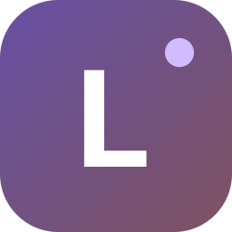
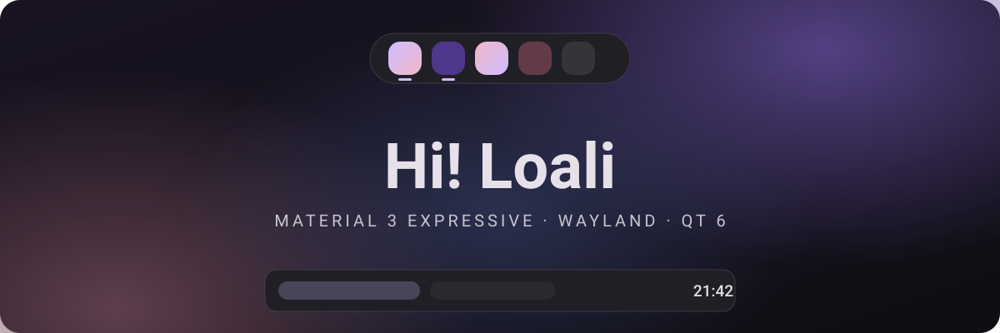
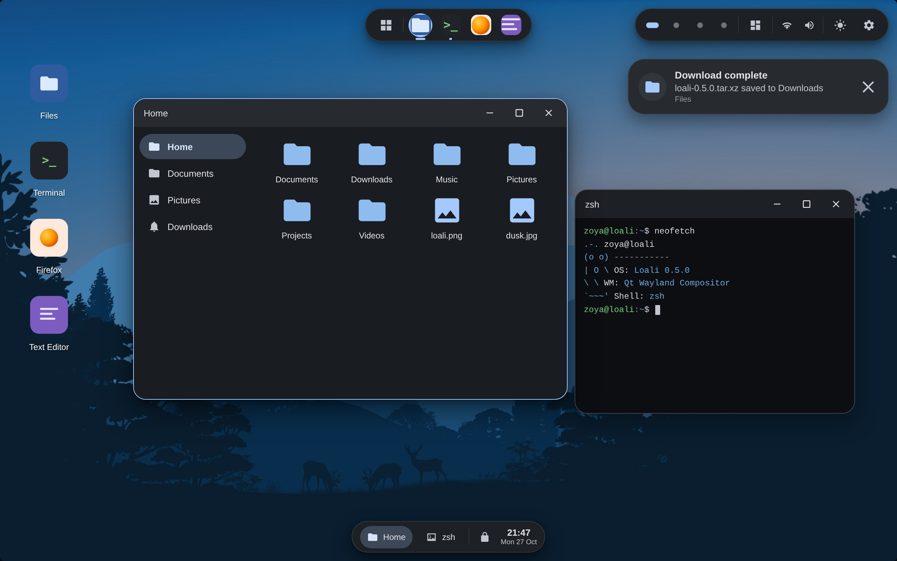
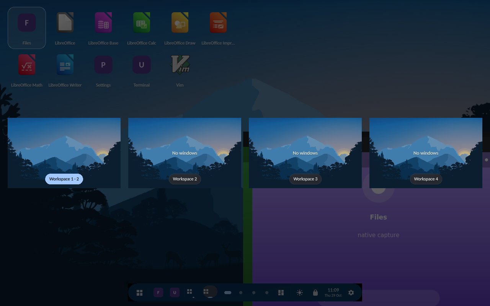
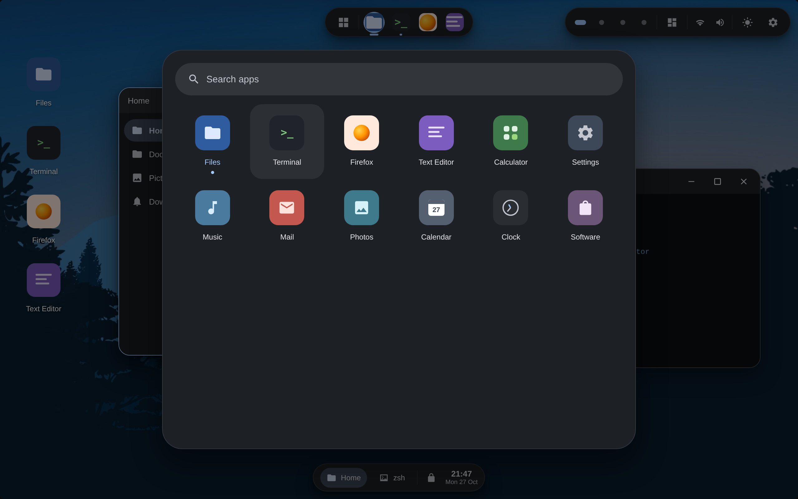
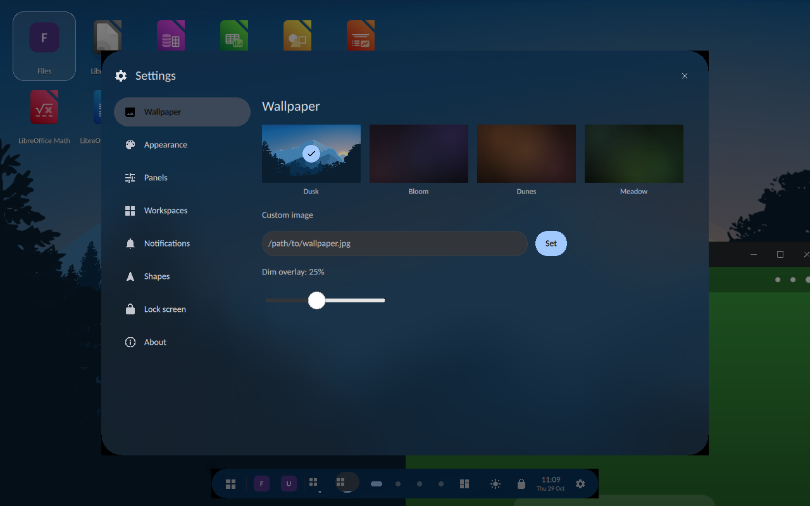

<div align="center">
  
</div>

<div align="center">
  
</div>

<div align="center">

# Hi! Loali

**Material 3 Expressive desktop environment for Linux — built with Qt 6, QML and Wayland**

[](https://github.com/mel0k1/Loali/actions/workflows/ci.yml)
[](LICENSE)
[](https://www.qt.io/)
[](https://wayland.freedesktop.org/)
[](CONTRIBUTING.md)

</div>

---

**Loali** is a lightweight, expressive desktop shell for Linux. It is a real Wayland compositor written in C++ and QML on top of Qt Wayland Compositor — the same technology used by production display servers. Instead of floating windows over an empty canvas, Loali brings a familiar and friendly layout: a **dock up top** (a morphing Dynamic Island or a flat plane), a **taskbar at the bottom** (a streamlined floating pill or a classic full-width bar), and **icons living right on the desktop**, all wrapped in the bold shapes, vivid tonal colors and springy motion of Material 3 Expressive.

<div align="center">
  <a href="docs/screenshots/desktop.png"></a>
  <a href="docs/screenshots/expo.png"></a>
  <br/>
  <a href="docs/screenshots/launcher.png"></a>
  <a href="docs/screenshots/settings.png"></a>
  <p><em>Desktop · workspace overview (Super+W) · app launcher (Super+A) · Settings → Panels (Super+S)</em></p>
</div>

## Features

- **Native Wayland compositor** — Loali *is* the display server, built with the official Qt Wayland Compositor API (XdgShell, server-side decorations, popups).
- **Top dock** — two looks: a **Dynamic Island** pill that breathes with hover and app launches (it widens, shows the launched app’s title, then tucks back), or a flat full-width plane; pinned apps, springy hover magnification and running indicators in both.
- **Status pill** — workspace dots, a StatusNotifier system tray and a settings button, floating at the top right.
- **Bottom taskbar** — two styles: a **streamlined floating pill** that stays out of the corners and widens only when tasks overflow, or a classic full-width bar; window buttons, a lock shortcut and a live clock.
- **Panel size control** — a single slider in Settings → Panels scales the dock, taskbar and status pill together (70–130 %), and maximized windows keep their work area in sync automatically.
- **Desktop icons** — a grid of installed applications directly on the wallpaper, with selection and double-click launch.
- **App launcher** — a searchable tile grid that adapts to the window width, marks running apps with a tinted label and an indicator dot, and re-focuses a running app instead of launching a second copy; tiles can be **dragged to reorder** (the grid reflows with move animations and the order persists across sessions) and **pinned to the top** with the pin chip or a right-click.
- **Real screenshot capture** — the compositor implements `zwlr_screencopy_manager_v1` (v3, including `capture_output_region` and `copy_with_damage`) and `zxdg_output_manager_v1` (v3), so standard tools like `grim` take actual screenshots of the live shell: `WAYLAND_DISPLAY=… grim shot.png`. The CI runs the compositor headless under Xvfb with bundled demo clients (`--demo launcher|settings|expo`) and uploads desktop / launcher / settings / expo captures as artifacts.
- **Virtual workspaces** — 2–6 independent desktops with an animated switcher in the status pill, `Super+1…6` to switch and `Super+Shift+1…6` to send windows across.
- **Window tiling** — snap windows to halves and quarters with `Super`-arrows or by dragging them to screen edges, with a live M3 snap preview and animated transitions; drag a tiled window to restore it.
- **System tray** — a full StatusNotifierWatcher implementation over D-Bus: tray items register, expose icons (theme names or ARGB pixmaps) and react to activate / secondary-activate clicks; icons can be **reordered by dragging** and the layout persists across sessions.
- **DBusMenu tray menus** — right-clicking a tray item renders its real `com.canonical.dbusmenu` menu as a native M3 popup: labels, icons, separators, check and radio entries, unlimited submenu navigation, live layout updates — the same protocol KDE and GNOME tray extensions speak.
- **Workspace overview (expo)** — `Super+W` zooms out into an expo of every workspace with **live window previews**: windows keep rendering inside scaled workspace cells, click a cell to jump there, drag a window between cells to move it across workspaces, or just click a window to open its desktop.
- **Dark / light theme** — a one-tap toggle (status pill or Settings → Appearance) switches the entire M3 token set between the dark and light Material schemes, Obsidian-style; the dynamic Material You palette is regenerated for the chosen mode and persisted.
- **Notifications daemon** — a real `org.freedesktop.Notifications` server on the session bus: summary, body, app icons and image hints render as M3 cards stacked in the corner, actions are forwarded back to the sender, critical alerts stay on screen, and Do Not Disturb lives in Settings.
- **Dynamic Material You color** — the seed color is extracted from the wallpaper (Wu quantizer + scoring) and a full Material 3 tonal scheme is generated with Google’s `material-color-utilities` (HCT / CAM16); dock, taskbar, windows, launcher and settings all recolor live.
- **Material You fine-tuning** — seven wallpaper styles straight from Android 12+ (**Tonal spot, Vibrant, Expressive, Content, Fruit salad, Rainbow, Monochrome**), a contrast level from muted (−1) to high (+1), and a manual accent that re-tints the entire scheme — not just a highlight color.
- **Settings application** — a built-in M3 settings app with wallpaper (bundled art, custom image path, dim overlay), appearance (dark/light, dynamic color, wallpaper style, contrast, accent), panels (taskbar style, dock look, panel size), workspace count, a shortcut cheat-sheet and an about page; everything persists via QSettings.
- **Wallpapers** — a bundled default artwork plus procedural M3E gradient styles, applied to the desktop and the lock screen.
- **Window management** — server-side title bars, drag, 8-way resize, maximize, fullscreen, minimize, click-to-focus.
- **Lock screen** — large M3 display-style clock over a dimmed wallpaper.
- **Material 3 Expressive design** — dark and light tonal palettes, 18–32 px corner radii, emphasized easing curves and spring animations.
- **Automatic app discovery** — parses `.desktop` files from standard XDG locations, with a themed-icon provider and graceful fallback icons.

## Keyboard shortcuts

| Keys | Action |
| --- | --- |
| `Super + 1…6` | Switch workspace |
| `Super + Shift + 1…6` | Move window to workspace |
| `Super + ← / →` | Snap window to left / right half |
| `Super + Alt + ←↑→↓` | Snap window to a corner |
| `Super + ↑` | Maximize |
| `Super + ↓` | Restore / minimize |
| `Super + F` | Toggle fullscreen |
| `Super + W` | Workspace overview (expo) |
| `Super + D` | Show desktop |
| `Super + A` | App launcher |
| `Super + S` | Settings |
| `Alt + F4` | Close window |
| `Ctrl + Alt + L` | Lock screen |

Dragging a window to the left / right screen edge snaps it to that half, dragging to the top edge maximizes it. Inside the expo, windows can be dragged between workspace cells to move them across desktops.

## Getting started

### Dependencies

| Distro | Packages |
| --- | --- |
| Debian / Ubuntu | `build-essential cmake ninja-build qt6-base-dev qt6-declarative-dev qt6-wayland-dev libwayland-dev` |
| Arch | `base-devel cmake ninja qt6-base qt6-declarative qt6-wayland wayland` |
| Fedora | `gcc-c++ cmake ninja-build qt6-qtbase-devel qt6-qtdeclarative-devel qt6-qtwayland-devel wayland-devel` |

Runtime QML modules (Debian/Ubuntu naming): `qml6-module-qtquick-controls`, `qml6-module-qtquick-layouts`, `qml6-module-qtquick-window`, `qml6-module-qtquick-shapes`, `qml6-module-qtwayland-compositor`.

### Build

```bash
git clone https://github.com/mel0k1/Loali.git
cd Loali
cmake -B build -G Ninja -DCMAKE_BUILD_TYPE=Release
cmake --build build
```

### Run

The easiest way to try Loali is a **nested window** inside your current session:

```bash
./build/loali
```

Launch Wayland clients against it with `WAYLAND_DISPLAY` printed by Loali at startup, for example:

```bash
WAYLAND_DISPLAY=wayland-1 QT_QPA_PLATFORM=wayland konsole
```

For a fullscreen nested window use `./build/loali --fullscreen`.

### Install as a session

```bash
sudo cmake --install build
```

This installs the `loali` binary, a `loali.desktop` application entry and a Wayland session file, so **Loali** appears in your display manager session list (SDDM, GDM, Ly, …).

## Architecture

```
Loali/
├── src/
│   ├── main.cpp              QGuiApplication + QML engine bootstrap
│   ├── apps.{h,cpp}          XDG .desktop scanner, model, pins, launcher
│   ├── settings.{h,cpp}      persisted shell settings singleton (QML: Settings)
│   ├── tray.{h,cpp}          StatusNotifierWatcher, tray model and image provider
│   ├── dbusmenu.{h,cpp}      com.canonical.dbusmenu client for tray context menus
│   ├── notifications.{h,cpp} freedesktop Notifications daemon, model and popups
│   ├── matcolor.{h,cpp}      Material You extraction + tonal schemes (QML: MatColor)
│   ├── screencopy.{h,cpp}    zwlr_screencopy_manager_v1 — grim-compatible screen capture
│   ├── xdgoutput.{h,cpp}     zxdg_output_manager_v1 — output names and logical geometry
│   ├── mat/                  vendored material-color-utilities C++ (Apache-2.0)
│   └── iconprovider.{h,cpp}  themed QIcon image provider with M3 fallback
├── protocols/                vendored protocol XMLs (xdg-output, wlr-screencopy)
├── tools/
│   └── lodemo.cpp            demo Wayland client used by the screenshot pipeline
├── qml/
│   ├── Main.qml              WaylandCompositor, XdgShell, workspaces, shortcuts
│   ├── Chrome.qml            server-side decorations, drag/resize, snap/tiling
│   ├── Dock.qml              top dock (Dynamic Island / plane modes, pinned apps)
│   ├── StatusPill.qml        workspaces switcher, expo button, tray icons, theme toggle
│   ├── TrayMenuPanel.qml     M3 popup renderer for DBusMenu tray menus
│   ├── Expo.qml              workspace overview with live window previews
│   ├── Taskbar.qml           bottom taskbar (floating / full modes, lock, clock)
│   ├── Desktop.qml           wallpaper + desktop icon grid
│   ├── Launcher.qml          app grid overlay with search
│   ├── SettingsApp.qml       settings: wallpaper, appearance, panels, workspaces, notifications, about
│   ├── NotificationPopups.qml  M3 notification cards stacked top-right
│   ├── LockScreen.qml        lock overlay with big clock
│   ├── Wallpaper.qml         image / procedural wallpapers with dim overlay
│   ├── Theme.qml             Material 3 design tokens (singleton)
│   ├── MIcon.qml             Material Symbols path renderer
│   └── Shadow.qml            layered soft shadow
└── assets/
    ├── logo.svg              Loali flower icon
    └── wallpapers/           bundled default wallpaper
```

The shell follows the reference Qt compositor pattern: `XdgShell.onToplevelCreated` creates a `Chrome` (a `ShellSurfaceItem` wrapped in a rounded container with a title bar). Windows are tracked in a `ListModel` that drives both the taskbar and the dock, and `XdgDecorationManagerV1` requests server-side decorations so client windows integrate seamlessly with the M3 look. The tray is a real `org.kde.StatusNotifierWatcher` on the session bus — tray apps register themselves, and their icons are exposed to QML through a dedicated `image://sni/` provider. Notification clients hit `org.freedesktop.Notifications`, which feeds the popup model. When the wallpaper changes, `MatColor` re-quantizes it and regenerates both light and dark tonal schemes; `Theme.qml` binds every color role to the active scheme.

## Roadmap

- [x] Wayland compositor core with XdgShell
- [x] Top dock, bottom taskbar, desktop icons
- [x] App launcher with search
- [x] Lock screen
- [x] Virtual workspaces
- [x] Window tiling and snapping
- [x] StatusNotifier tray support
- [x] DBusMenu context menus for tray items
- [x] Settings application with wallpapers and accent color
- [x] Dynamic Material You color extraction from wallpaper
- [x] Notifications daemon
- [x] Dark / light theme toggle
- [x] Workspace expo with window previews
- [x] Floating taskbar and Dynamic Island dock, panel size settings
- [x] Material You fine-tuning: wallpaper styles and contrast
- [x] Launcher tile grid with running indicators
- [x] Launcher drag-reorder with pinning
- [x] wlr-screencopy and xdg-output protocols for real screenshots

## Contributing

Contributions are welcome! Please read [CONTRIBUTING.md](CONTRIBUTING.md) — keep commits short, keep code clean and comment-free, and follow the Material 3 Expressive language.

## License

Loali is licensed under the [GNU GPL-3.0](LICENSE). Material Symbols path data used by `MIcon.qml` is derived from [Material Design Icons](https://github.com/google/material-design-icons) (Apache-2.0). The `src/mat` directory contains a vendored subset of [material-color-utilities](https://github.com/material-foundation/material-color-utilities) (Apache-2.0, © Google LLC).

## Русский

**Loali** — лёгкая и выразительная графическая среда для Linux. Это настоящий Wayland-композитор на C++ и QML поверх Qt Wayland Compositor. Знакомая раскладка в смелом стиле Material 3 Expressive: **док сверху** (морфирующий Dynamic Island или плоская полоса), **панель задач снизу** (обтекаемая плавающая пилюля или классическая полоса во всю ширину), **иконки прямо на рабочем столе**.

<div align="center">
  <a href="docs/screenshots/desktop.png"></a>
  <a href="docs/screenshots/expo.png"></a>
  <br/>
  <a href="docs/screenshots/launcher.png"></a>
  <a href="docs/screenshots/settings.png"></a>
</div>

Возможности: нативный Wayland-композитор (XdgShell, серверные декорации), верхний док с двумя видами — **Dynamic Island** (пилюля дышит при наведении и запуске приложений: расширяется, показывает название запущенного приложения и складывается обратно) и плоская полоса во всю ширину, статус-пилюля с переключателем рабочих столов, кнопкой экспо, системным треем и переключателем темы, нижний таскбар с двумя стилями — **обтекаемая плавающая пилюля**, которая не тянется по углам и расширяется только при переполнении задачами, либо классическая полоса, сетка иконок на рабочем столе, **лаунчер-плитки** — адаптивная сетка под ширину окна с индикаторами запущенных приложений и фокусом на уже запущенном приложении вместо повторного запуска, плитки **перетаскиваются для сортировки** (сетка переезжает с анимациями, порядок сохраняется между сессиями) и **закрепляются наверху** пин-кнопкой или правым кликом, **настройка размера панелей** — один слайдер в Настройки → Панели масштабирует док, таскбар и статус-пилюлю (70–130 %), область разворачивания окон синхронизируется автоматически, **виртуальные рабочие столы** (2–6, переключение `Super+1…6`, перенос окон `Super+Shift+1…6`), **экспо рабочих столов** (`Super+W`) с живыми превью окон: клик по ячейке переключает стол, перетаскивание окна между ячейками переносит его между столами, **тайлинг окон** — половины и углы по `Super`-стрелкам и перетаскиванием к краям экрана с живым превью, **меню трея по DBusMenu** — правый клик по иконке трея показывает настоящее меню `com.canonical.dbusmenu` (иконки, разделители, галочки, радиокнопки, подменю), **drag-упорядочивание иконок трея** — порядок сохраняется между сессиями, **светлая и тёмная темы** — переключение всего набора токенов M3 одним тапом, **демон уведомлений** `org.freedesktop.Notifications` — карточки M3 с действиями, критические алерты и режим «Не беспокоить», **динамический цвет Material You** — палитра генерируется из обоев (квантизатор Wu + HCT/CAM16 из material-color-utilities), интерфейс перекрашивается на лету, **тонкая доводка Material You** — семь стилей обоев как в Android 12+ (**Tonal spot, Vibrant, Expressive, Content, Fruit salad, Rainbow, Monochrome**), уровень контраста от приглушенного (−1) до высокого (+1) и ручной акцент, который перекрашивает всю схему целиком, **приложение «Настройки»** — обои (встроенные, свой файл, затемнение), тёмная тема, динамический и ручной акцент, стиль обоев и контраст, панели (стиль таскбара, вид дока, размер), число рабочих столов, уведомления, шпаргалка по клавишам, перетаскивание, изменение размера с 8 сторон, разворачивание, сворачивание, экран блокировки с большими часами, автоматический поиск приложений по `.desktop`-файлам.

Реальные скриншоты: композитор реализует протоколы `zwlr_screencopy_manager_v1` (v3) и `zxdg_output_manager_v1` (v3), поэтому обычные инструменты вроде `grim` снимают живой шелл — `WAYLAND_DISPLAY=… grim shot.png`. В CI композитор запускается безголовым под Xvfb с демо-клиентом (`tools/lodemo`) и режимом `--demo launcher|settings|expo`, а снимки рабочего стола, лаунчера, настроек и экспо выкладываются артефактами сборки.

Сборка и запуск:

```bash
cmake -B build -G Ninja -DCMAKE_BUILD_TYPE=Release
cmake --build build
./build/loali
```

Клиенты подключаются через `WAYLAND_DISPLAY`, который Loali печатает при старте. Установка сессии: `sudo cmake --install build` — после этого Loali появится в списке сессий менеджера входа.

Лицензия — [GPL-3.0](LICENSE).
