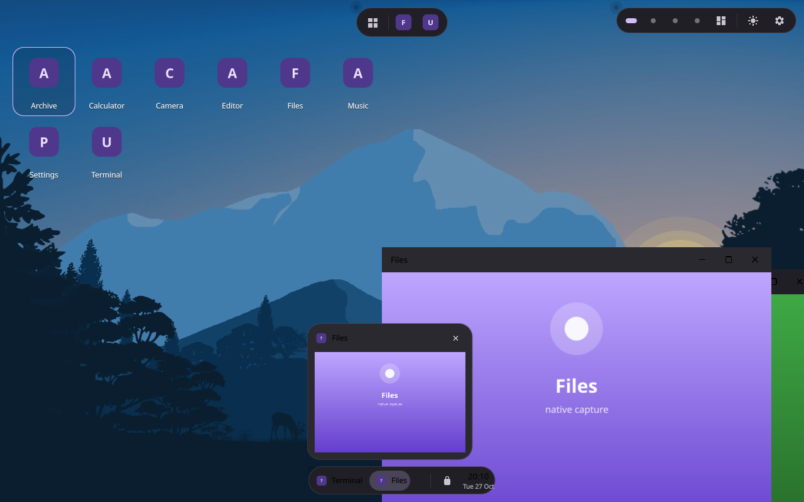
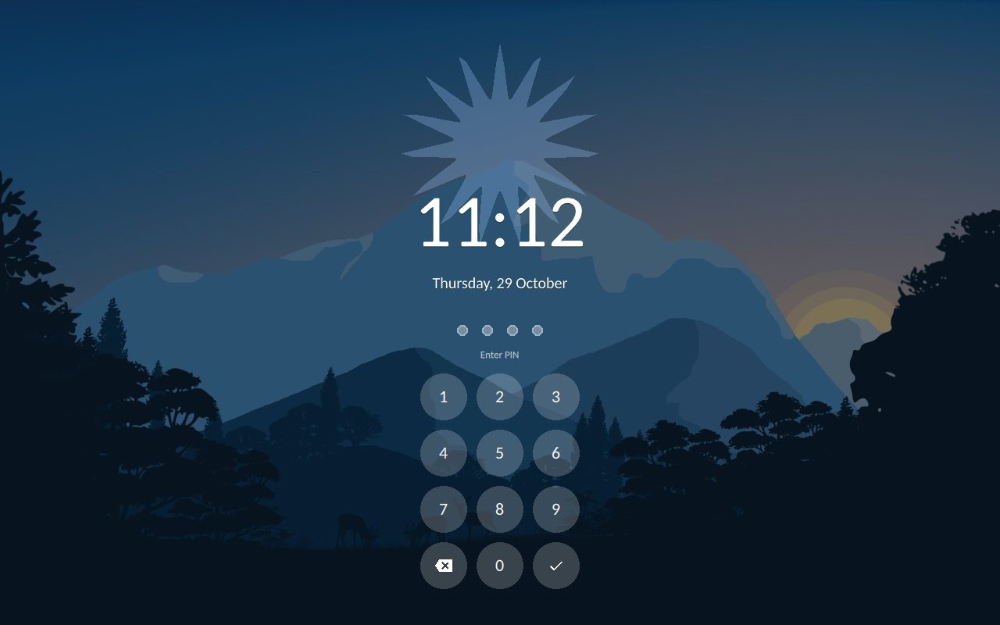
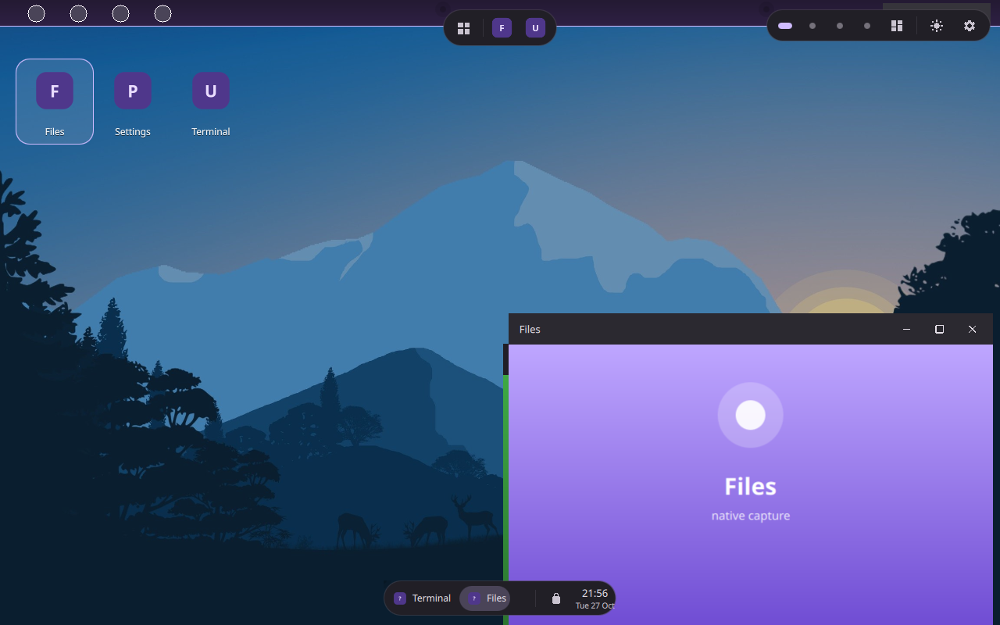
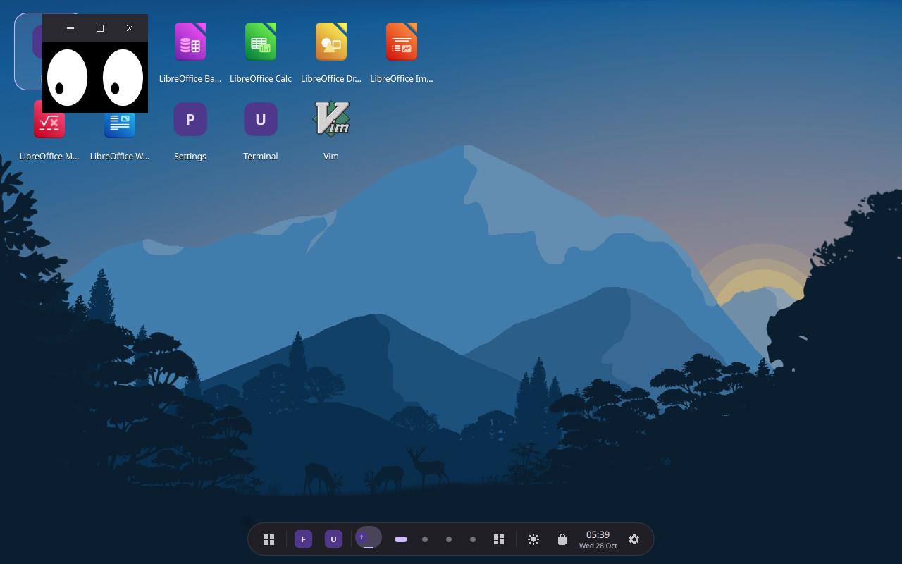

<div align="center">
  
  
</div>

<div align="center">

# Hi! Loali

**Material 3 Expressive desktop environment — a real Wayland compositor in Qt 6 / QML**

[](https://github.com/mel0k1/Loali/actions/workflows/ci.yml)
[](LICENSE)
[](https://www.qt.io/)
[](https://wayland.freedesktop.org/)

</div>

Loali *is* the display server: a lightweight desktop shell written in C++ and QML on Qt Wayland Compositor. A dock up top (morphing Dynamic Island or flat plane), a taskbar at the bottom, icons on the desktop — all in the bold shapes and springy motion of Material 3 Expressive.

<div align="center">
  <a href="docs/screenshots/desktop.png"></a>
  <a href="docs/screenshots/expo.png"></a>
  <br/>
  <a href="docs/screenshots/launcher.png"></a>
  <a href="docs/screenshots/settings.png"></a>
  <br/>
  <a href="docs/screenshots/taskbar.png"></a>
  <a href="docs/screenshots/lock.png"></a>
  <br/>
  <a href="docs/screenshots/layer.png"></a>
  <a href="docs/screenshots/xwayland.png"></a>
  <p><em>Desktop · expo (Super+W) · launcher (Super+A) · Settings (Super+S) · taskbar live preview · lock screen with PIN · third-party layer-shell panel · XWayland (xeyes)</em></p>
</div>

## Features

- **Compositor core** — XdgShell with server-side M3 decorations, XWayland (rootless, own XCB WM), layer shell for third-party panels, `wl_seat` v5 so stock `foot` runs as-is.
- **Dock** — Dynamic Island pill or flat plane: launcher, pinned apps, live window thumbnails, tray, workspace dots, clock.
- **Workspaces** — 2–6 desktops, `Super+1…6`, drag windows between them in the expo grid with live previews.
- **Tiling** — halves, quarters and maximize via `Super`-arrows or edge-drag, with animated snap previews.
- **Desktop icons** — drag one onto another to make a folder; layout and folders persist.
- **Launcher** — searchable, paginated, drag-reorder, pin-to-top, focuses running apps instead of relaunching.
- **Material You color** — tonal scheme generated from the wallpaper (material-color-utilities), 7 Android-12 styles, contrast and accent tuning, dark/light toggle; the wallpaper also tints dock, launcher, tray menus and notification cards.
- **Session services** — StatusNotifier tray with DBusMenu menus, Notifications daemon, `org.freedesktop.ScreenSaver` inhibition, logind power actions.
- **Portals** — Screenshot and ScreenCast (`org.freedesktop.impl.portal.*`) backed by PipeWire screencast nodes.
- **Screencopy** — `zwlr_screencopy_manager_v1` + own `wl_output` v4 global, so `grim` captures the shell natively; `loali --screenshot shot.png` uses the same path.
- **Lock screen** — idle blanking locks the session (DPMS + `ext_idle_notify_v1`), unlock by click or a **numeric PIN** set in Settings (kept only as a salted PBKDF2-SHA256 hash, 60k iterations); `ext-session-lock-v1` and logind sleep/lock signals follow the same path.
- **Watchdog** — clients that stop answering `xdg_wm_base` pings are killed after a pong timeout.
- **Settings app** — wallpapers, appearance, panels, workspaces, notifications, lock screen — all persisted via QSettings.

## Keyboard shortcuts

| Keys | Action |
| --- | --- |
| `Super + 1…6` | Switch workspace |
| `Super + Shift + 1…6` | Move window to workspace |
| `Super + ← / → / ↑ / ↓` | Snap / maximize / restore |
| `Super + Alt + ←↑→↓` | Snap to corner |
| `Super + F` | Fullscreen |
| `Super + W` | Workspace overview |
| `Super + D` | Show desktop |
| `Super + A` | App launcher |
| `Super + S` | Settings |
| `Alt + F4` | Close window |
| `Ctrl + Alt + L` | Lock screen |

## Build & run

```bash
git clone https://github.com/mel0k1/Loali.git
cd Loali
cmake -B build -G Ninja -DCMAKE_BUILD_TYPE=Release
cmake --build build
./build/loali
```

Dependencies (Debian/Ubuntu): `build-essential cmake ninja-build qt6-base-dev qt6-declarative-dev qt6-wayland-dev libwayland-dev` plus the `qml6-module-qtquick-*` runtime modules. PipeWire is optional and enables the screencast portal.

Run nested inside your current session, connect clients via the printed `WAYLAND_DISPLAY`, or install as a real session with `sudo cmake --install build` (adds `loali.desktop` and a Wayland session entry for SDDM/GDM/Ly).

## Tested in CI

Every commit builds on Qt 6.4 and Qt 6.9 and runs headless E2E: idle notifications, DPMS, clipboard (`wl-copy`/`wl-paste`), blur, session lock, screen locking on idle, screenshot and screencast portals, a real `foot` client — and an unresponsive client that must be killed by the pong watchdog. Screenshots are captured with the compositor's own screencopy path and uploaded as artifacts.

## Contributing

Please read [CONTRIBUTING.md](CONTRIBUTING.md) — short commits, clean comment-free code, Material 3 Expressive language.

## License

[GPL-3.0](LICENSE). `MIcon.qml` path data is derived from [Material Design Icons](https://github.com/google/material-design-icons); `src/mat` vendors a subset of [material-color-utilities](https://github.com/material-foundation/material-color-utilities) (both Apache-2.0, © Google LLC).

## Русский

**Loali** — лёгкая графическая среда для Linux и настоящий Wayland-композитор на C++/QML (Qt Wayland Compositor): док сверху (Dynamic Island или плоскость), панель задач снизу, иконки на рабочем столе — всё в стиле Material 3 Expressive. Внутри: XWayland, layer-shell, лаунчер, экспо рабочих столов, тайлинг, трей с DBusMenu, демон уведомлений, порталы скриншота и скринкаста (PipeWire), блокировка экрана по бездействию с PIN-кодом и защита от зависших клиентов. Динамическая палитра Material You генерируется из обоев. Сборка и запуск — три команды выше, установка сессии — `sudo cmake --install build`. Лицензия — [GPL-3.0](LICENSE).
